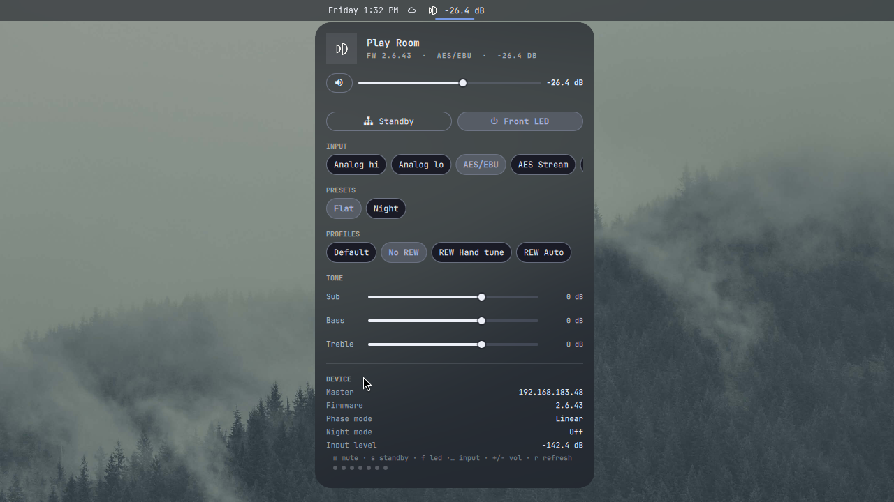
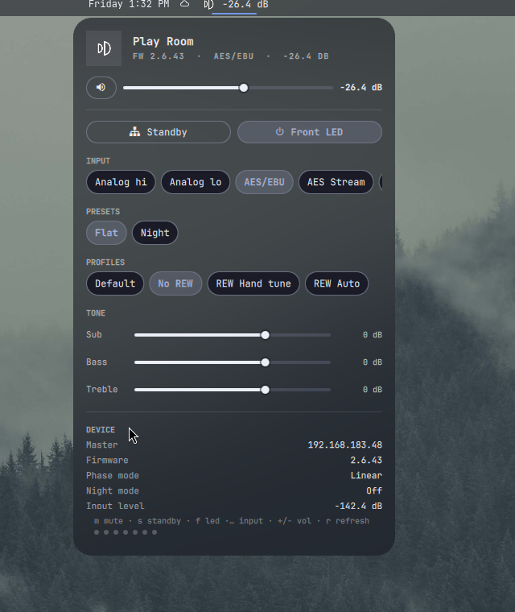

# Dutch & Dutch 8C

[](https://github.com/tcballard/omarchy-badges)

Control your Dutch & Dutch 8c/6c room straight from the Omarchy bar:
gain, mute, standby, input select, presets, RoomMatching profiles, tone
controls, front LED, and live device status. No cloud, no vendor app —
the bundled CLI speaks the speakers' local mesh API directly.



## Why

The official Ascend app wants you on their network stack, and the
network-streaming license (Roon/Spotify via AES Streamer) is a €2k+
option. If you feed the 8Cs analog or AES3 like everyone else, you still
deserve a volume knob on the desktop. This widget gives you the whole
unlicensed control surface — the same endpoints the vendor's own web app
uses — plus a scriptable CLI, in the style of the Omarchy bar.

## What you get

- **Bar chip** — the Dutch & Dutch monogram + live gain. Scroll = ±1 dB,
  middle-click = mute, click = panel. Dim = offline, faint = standby.
- **Keyboard-first panel** — volume, standby, front LED, input select
  (Analog hi/lo · AES/EBU · AES Streamer · File Player), presets,
  RoomMatching profiles, tone (sub/bass/treble), device info.
- **CLI + IPC** — drive it from scripts, keybindings or dotfiles.
- **Stdlib only** — the daemon is pure Python 3, no pip dependencies.



## Bar chip


- **Click** — open/close the control panel
- **Middle-click** — mute toggle
- **Scroll** — gain ±`volStepTenths`/10 dB (default 0.1 dB)

## Panel keys

- `Tab` / `j` `k` — sections · `h` `l` — adjust within section
- `Enter` — activate focused control · `Space` — mute
- `m` mute · `s` standby · `f` front LED · `i` cycle input · `1`–`5` pick
  input · `+`/`-` volume · `r` refresh
- **Hold to accelerate**: held volume keys (and fast scrolling) start at
  `volStepTenths`/10 dB (default 0.1) and escalate to 2× then 5× (max 0.5 dB)
  per step) while the burst continues; release
  and the step resets. Rapid stepping never bounces — the widget keeps
  command authority over device echoes until the burst settles.

## Summon without the bar

```
omarchy-shell shell toggle ric.dd8c   # bind to a key if you like
```

IPC for scripts:

```
quickshell ipc call ric.dd8c volSet -22
quickshell ipc call ric.dd8c mute on
quickshell ipc call ric.dd8c input aes
```

## CLI (same engine the widget uses)

```
bin/dd8c discover                 # find speakers via mDNS
bin/dd8c status                   # full room snapshot (JSON)
bin/dd8c vol -27                  # absolute dB (clamped to device limits)
bin/dd8c mute on|off
bin/dd8c sleep on|off
bin/dd8c input aes|analogHighGain|analogLowGain|AES\ Streamer|File\ Player
bin/dd8c preset Flat
bin/dd8c profile "REW Auto"
bin/dd8c tone --bass 2 --treble -1
```

## Settings (shell.json layout entry)

| key | default | meaning |
|---|---|---|
| `masterIp` | your master's IP | master speaker; `""` = mDNS discovery |
| `volStepTenths` | `1` | base scroll/arrow gain step in 0.1 dB units (1 = 0.1 dB) |
| `barText` | `true` | show gain readout |
| `fixture` | `false` | demo data, no device |

## Safety

The daemon never sends firmware install/reset verbs and clamps gain to
the limits the room document advertises. It only writes endpoints that
the vendor's own web app uses for these controls. Read-only by default;
every write is an explicit command.

## Requirements

- Omarchy 4 with Quattro shell-plugin support.
- Python 3 (stdlib only; no pip dependencies).
- Speakers on the same LAN, reachable at `ws://<master>:8768`.

## Installation

```bash
omarchy plugin add https://github.com/keylimesoda/ric.dd8c.git --enable
```

For a local checkout:

```bash
omarchy plugin add "$(pwd)" --enable
```

To remove:

```bash
omarchy plugin remove ric.dd8c
```

## Tests

```
./tests/run
```

Runs manifest validation, the daemon end-to-end against a fixture
WebSocket server (no speakers needed), and Model.js unit tests.

## Credits & trademark note

The monogram in `assets/` and the panel is trademark **Dutch & Dutch**,
taken from their public site favicon and used here only to label the
user's own speakers. This is an unofficial community plugin; the local
mesh protocol was reverse-engineered from the vendor's own web app
traffic. Not affiliated with Dutch & Dutch.

MIT licensed — see [LICENSE](LICENSE). Design decisions live in
[DESIGN.md](DESIGN.md).
